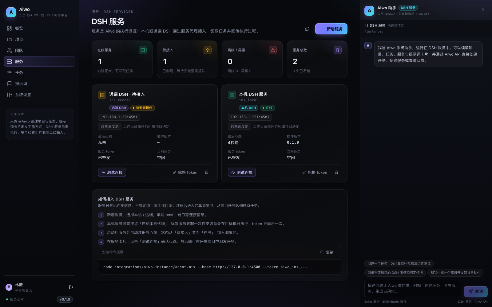
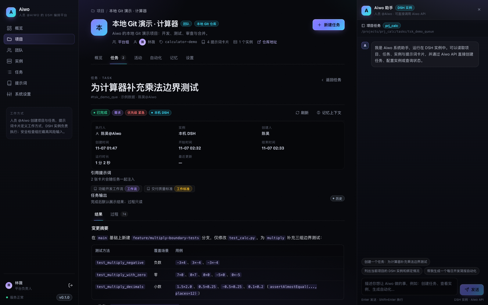
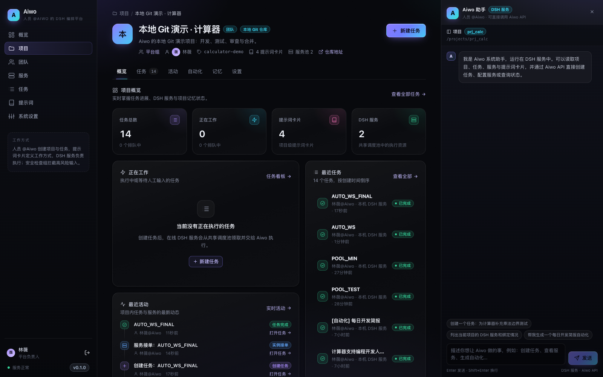
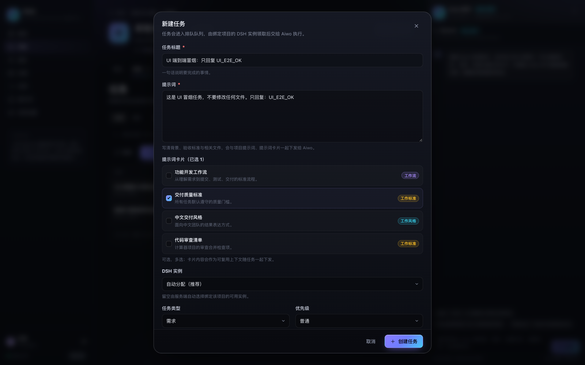
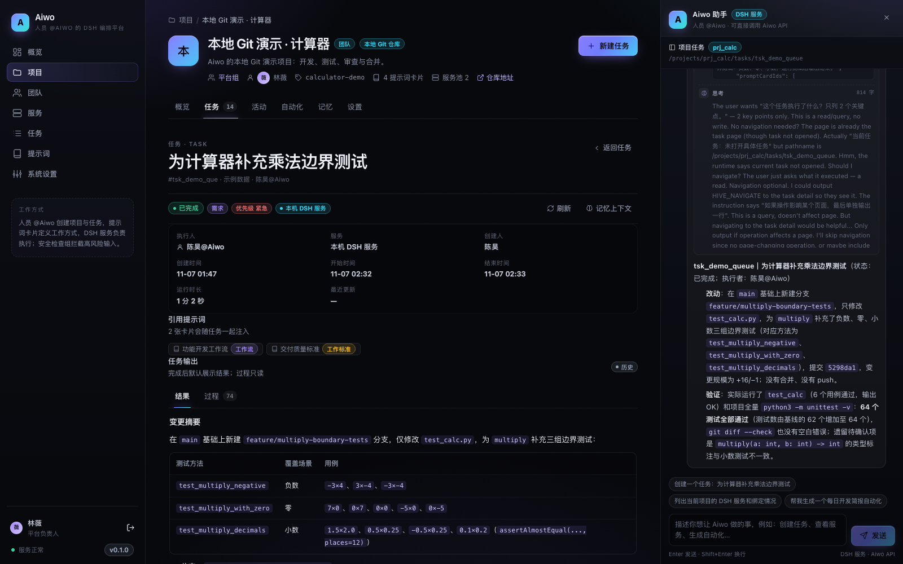

# Aiwo · 人员 @Aiwo 的 DSH 编排平台

Aiwo 是一个管理 **DSH 实例资源** 的团队协作与任务平台。它没有“智员”概念：每个任务的执行者固定显示为 **人员@Aiwo**，由绑定的 DSH 实例真正执行。

参考 Hive 的工程结构，但运行时模型完全不同：

- **人员**：Aiwo 用户，登录、组队、管项目、管实例。
- **提示词卡片**：工作流、风格、标准、角色说明；任务/自动化按需引用，内容注入 DSH 提示词。
- **DSH 实例**：Aiwo 的独立资源；本机或远端，带 token、心跳、绑定项目、当前任务、插件版本。
- **任务**：项目任务，执行身份 `姓名@Aiwo`；一次性 `/goal`，执行过程只读；ACP 会话按项目的 `workspacePath` 创建，同一项目的任务/对话共享同一工作区目录。
- **项目 / 团队 / 人员**：与 Hive 一致。
- **助手**：右侧常驻的 DSH 助手，SSE 流式输出（状态/思考/工具/文本）。思考与工具调用按过程块逐段出现：执行中折叠历史、展开当前；最终答案开始后自动折叠全部过程，点击「展开」可回看。可读项目/实例/任务/提示词卡片并直接调用 Aiwo 开放 API。
- **记忆**：项目接入 Mnemos；任务开始注入项目记忆，完成写回结论/决策/经验。
- **安全检查**：任务与助手输入可经独立 LLM 检查；系统设置里配置 endpoint，空则关闭。

## 架构

```text
┌──────────────┐  ┌───────────────────────────┐  ┌─────────────────┐
│ 导航          │  │ 内容（项目 / 任务详情页）    │  │ Aiwo 助手（DSH） │
│ 概览/项目/…   │  │ 任务表 / 提示词 / 设置      │  │ 右栏常驻        │
└──────────────┘  └─────────────┬─────────────┘  └────────┬────────┘
                                │                         │
                                ▼                         ▼
                       ┌──────────────────────────────────────┐
                       │ Aiwo 控制面（Node 26 + SQLite）        │
                       │ 人员/团队/项目/卡片/实例/任务/自动化     │
                       └───────┬──────────────────────┬───────┘
                               │                      │
                    运行时协议 │                      │ Mnemos /v1
                               ▼                      ▼
                    ┌──────────────────┐      ┌──────────────┐
                    │ Aiwo 实例代理     │      │ Mnemos 记忆   │
                    │ 本机 / 远端       │      └──────────────┘
                    └────────┬─────────┘
                             │ ACP v1（stdio）
                             ▼
                    ┌──────────────────┐
                    │ dsh --profile acp│
                    │ 常驻 DSH 实例      │
                    └──────────────────┘
```

### DSH 实例如何接入

1. 管理员在「实例」页新增实例，选择本机/远端、host、端口、workspace、绑定项目。
2. **本机实例**可直接点「启动本机代理」，Aiwo 自动轮换 token 并拉起代理；远端实例会拿到**一次性实例 token** 和安装命令。
3. 远端在目标主机执行（安装命令会从 Aiwo 直接下载代理包）：

```bash
curl -fsSL -H "authorization: Bearer aiwo_ins_xxx" \
  http://<aiwo-host>:4500/api/runtime/instances/agent-package | tar xz
cd aiwo-instance && npm install
AIWO_BASE_URL=http://<aiwo-host>:4500 \
AIWO_INSTANCE_TOKEN=aiwo_ins_xxx \
node agent.mjs --workspace /srv/aiwo-workspace --name my-dsh-01
```

4. 代理 outbound 注册 → 20s 心跳 → 5s claim → 本地启动常驻 `dsh --profile acp`，通过 ACP 执行任务、上报运行时事件、完成回写。
5. ACP 不可用时自动回退 `dsh --profile headless --json -`；远端 DSH 只需要安装这个代理，不需要暴露 ACP 端口。

> ACP 是 stdio JSON-RPC；远端无法直接 stdio 连接，所以由实例代理 outbound 连 Aiwo，代理在本地驱动 ACP。

## 快速开始

```bash
cd aiwo
pnpm install
pnpm seed                 # 写入演示数据（data/aiwo.db）
pnpm build                # 构建 web/dist
node server/src/main.ts    # http://127.0.0.1:4500
```

开发前端：

```bash
pnpm dev:web               # http://127.0.0.1:4501，代理 /api → 4500
```

演示账号（密码 `aiwo-demo`）：

| 邮箱 | 姓名 | 角色 |
| --- | --- | --- |
| `lin.wei@aiwo.dev` | 林薇 | 组织管理员 |
| `chen.hao@aiwo.dev` | 陈昊 | 团队负责人 |
| `zhou.ye@aiwo.dev` | 周野 | 成员 |
| `su.yan@aiwo.dev` | 苏妍 | 成员 |

演示项目：**本地 Git 演示 · 计算器**（`prj_calc`）。

本机实例安装命令（demo token 仅用于本地演示）：

```bash
node integrations/aiwo-instance/agent.mjs \
  --base http://127.0.0.1:4500 \
  --token aiwo_ins_demo_local_7f3a2c \
  --workspace /Volumes/wd2025/devel/aiworker/aiwo/.run/local-git-demo
```

## 任务模型

- 任务执行者：`创建人@Aiwo`，没有 agent_id
- 提示词：`/goal` + 项目提示词 + 引用的提示词卡片 + 任务要求
- 实例：任务可指定实例，也可由绑定项目的实例自动领取
- 状态：queued / assigned / running / done / failed / cancelled
- 执行过程：`session / thinking / text / tool_call / tool_result / status / final`
- 完成：写任务结果 + Mnemos 项目记忆（配置后）
- 无任务对话；任务详情页只读展示「结果 / 过程」

## 提示词卡片

- scope：组织 / 团队 / 项目
- category：工作流 / 工作风格 / 工作标准 / 角色说明 / 其他
- 任务与自动化都可以引用多张卡片；服务端校验卡片可用性
- 卡片内容只在执行时注入，不复制到任务 prompt 中

## 系统设置 / 安全检查

「系统设置」页：

- Endpoint 为空 → 安全检查关闭
- 填入 OpenAI 兼容的 `/v1/chat/completions` endpoint、model、API key
- 任务创建、助手对话前调用独立 LLM；返回 `{allowed:false,reason}` 则拦截
- 安全审计只记录输入 digest，不保存完整输入
- 助手使用实例可选；未指定时使用默认本地 DSH

## Mnemos

项目设置里填写 Mnemos 项目 ID / API Key / 项目记忆身份。任务 claim 时返回项目记忆配置，实例代理拉取上下文；完成后服务端写回结论/决策/经验。

演示环境可运行：

```bash
# Mnemos 需先启动在 http://127.0.0.1:4380
# 在项目设置中配置 Mnemos 项目 ID / Key
```

## Git / 测试

```bash
pnpm test          # 27 个后端测试
pnpm typecheck
pnpm build
pnpm --dir integrations/aiwo-instance test   # 8 个实例代理测试
```

## 截图

| 概览 | 实例资源 |
| --- | --- |
|  |  |

| 提示词卡片 | 系统设置 |
| --- | --- |
|  |  |

| 项目任务 | 任务详情 |
| --- | --- |
|  |  |

| 项目概览 | Aiwo 助手（DSH 实例） |
| --- | --- |
|  |  |

| 助手流式输出 | 新建任务引用提示词 |
| --- | --- |
|  |  |

| 过程实时展开 | 完成后自动折叠 |
| --- | --- |
|  |  |

| 展开历史过程 |
| --- |
|  |

## 目录

```text
aiwo/
├── server/                  # Aiwo 控制面（Node + node:sqlite）
├── shared/                  # 前后端契约
├── web/                     # React 控制台
├── integrations/
│   ├── aiwo-instance/       # DSH 实例代理（ACP + headless 回退）
│   └── assistant/           # DSH 助手 API helper
├── docs/                    # API / 架构
└── data/                    # 运行时数据库（gitignored）
```
