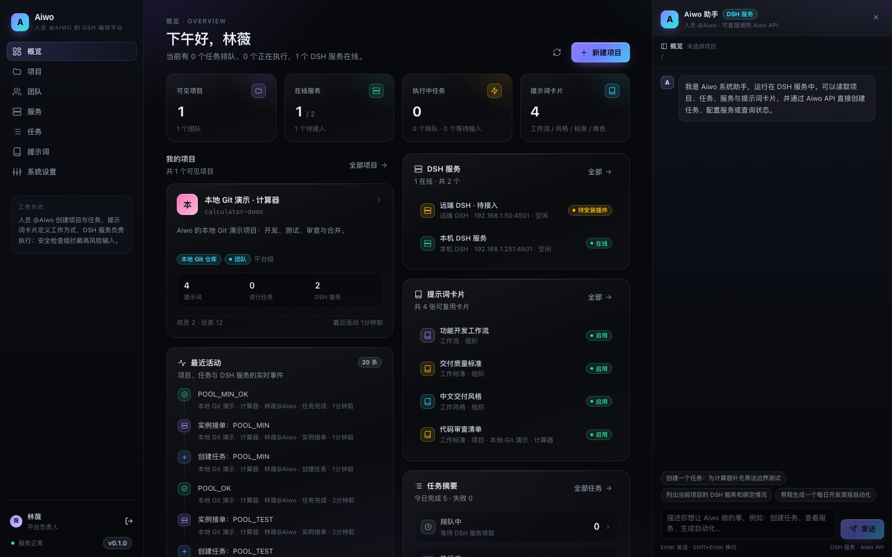
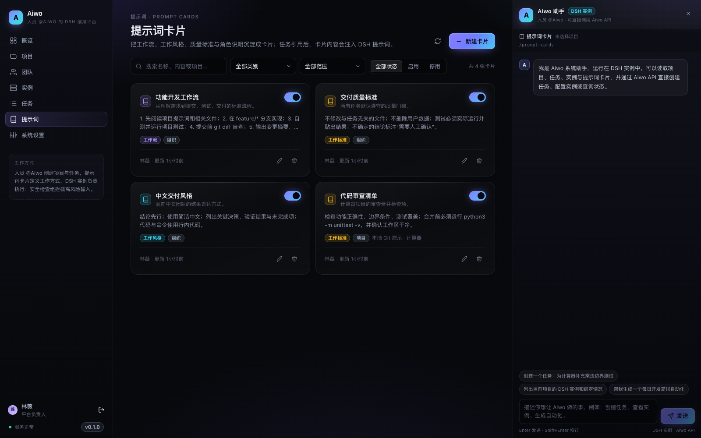
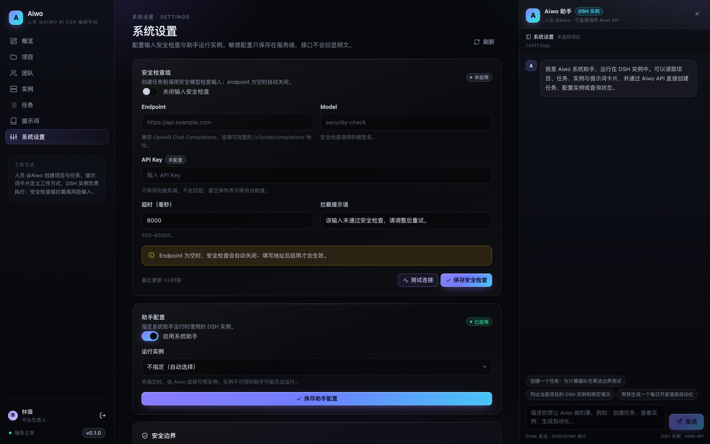
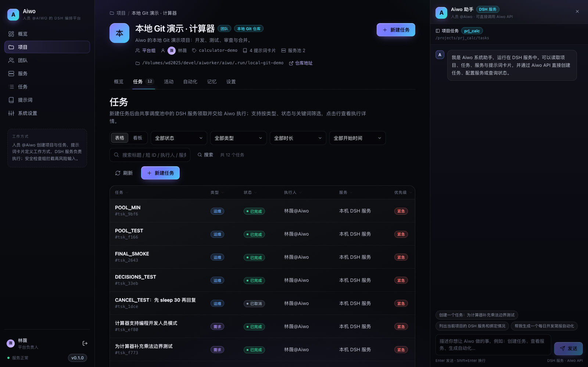
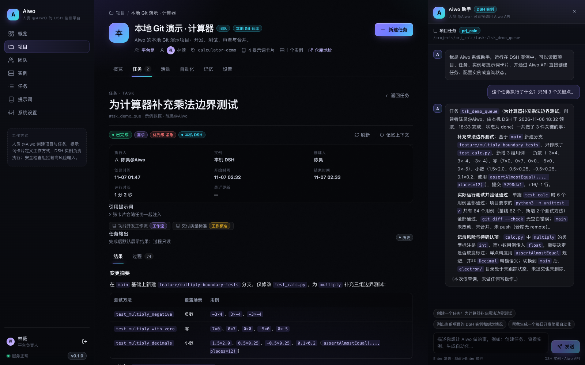
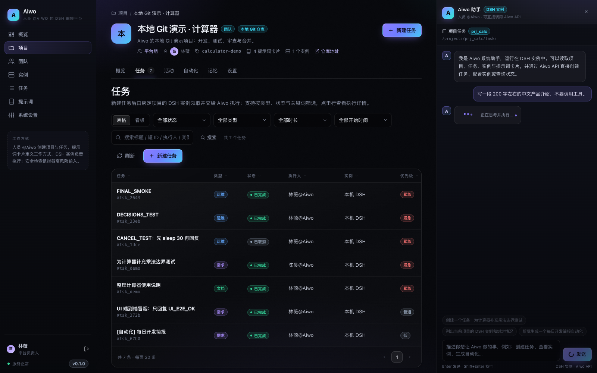
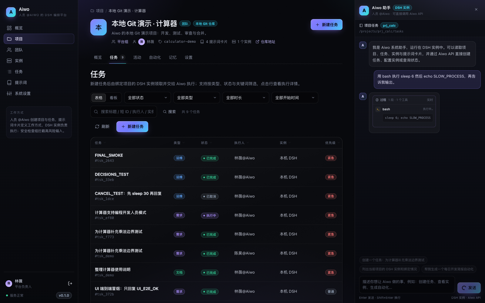
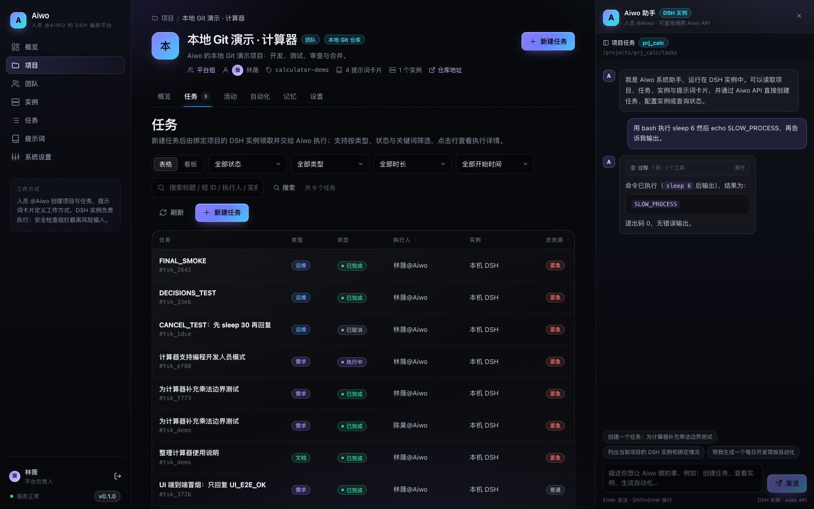

# Ryan · 人员 @Ryan 的 DSH 编排平台

Ryan 是一个面向员工的 **人机协作与智能体资源平台**。三个核心对象是：**员工账号、智能体资源、项目共享区**。

- **员工账号**：平台账户一般对应一位员工，可绑定企业微信作为统一身份；支持本地密码、组织认证和管理员权限。员工负责创建任务、维护项目上下文和验收结果。
- **智能体资源**：智能体是可调度的执行资源，运行在本机或远端主机上，例如 Linux 开发机或测试机；通过能力标签（如 `linux`、`build`、`test`）说明能承担的工作。智能体带 token、心跳、当前任务、插件版本和并发状态。
- **项目**：项目是 **跨智能体的共享信息区**，对应各智能体上的项目工作区。项目背景、提示卡、记忆、记录、任务和复盘在项目内共享；每个智能体在各自机器的 `projects/<projectId>` 目录执行，不共享文件系统，但共享项目信息。
- **任务**：项目内的执行单元；内容可以使用 `@员工`、`@智能体` 自然语言指定通知或执行资源。执行身份仍显示为 `员工@Ryan`。
- **提示卡**：工作流、风格、标准、角色说明；任务/自动化按需引用，内容注入 DSH 提示词，也可承载“完成后交给谁”的自然语言交接要求。
- **助手**：右侧常驻的 DSH 助手，SSE 流式输出（状态/思考/工具/文本）。思考与工具调用按过程块逐段出现：执行中折叠历史、展开当前；最终答案开始后自动折叠全部过程，点击「展开」可回看。助手运行在受限 DSH profile 中：禁用 bash、文件读写、搜索、web、subagent 等默认工具，只保留受控的 `aiwo_api` HTTP 工具；API 契约与前端路由表来自 `/api/assistant/manifest`，不读取源码；用户说“打开某个任务”时会先查任务再返回 `HIVE_NAVIGATE`。助手窗口支持新会话、会话历史、删除会话、编辑重发、重新生成和停止生成；下一步任务推荐由本机 DSH 根据当前页面和对话生成。
- **记忆**：Ryan 内置项目记忆；任务领取时注入最近的记忆简报（默认最多 500 字），需要更深背景时由 DSH 调用记忆工具检索；普通任务结果留在任务历史，只有决策/经验候选经做梦沉淀为持久知识。
- **安全检查**：任务与助手输入可经独立 LLM 检查；系统设置里配置 endpoint，空则关闭。

## 架构

```text
┌──────────────┐  ┌───────────────────────────┐  ┌─────────────────┐
│ 导航          │  │ 内容（项目 / 任务详情页）    │  │ Ryan 助手（DSH） │
│ 概览/项目/…   │  │ 任务表 / 提示卡 / 设置      │  │ 右栏常驻        │
└──────────────┘  └─────────────┬─────────────┘  └────────┬────────┘
                                │                         │
                                ▼                         ▼
                       ┌──────────────────────────────────────┐
                       │ Ryan 控制面（Node 26 + SQLite）        │
                       │ 员工/团队/项目/卡片/智能体/任务/自动化   │
                       └──────────────┬───────────────┘
                                      │ 运行时协议
                                      ▼
                           ┌──────────────────┐
                           │ 智能体执行代理     │
                           │ 本机 / 远端       │
                           └────────┬─────────┘
                             │ ACP v1（stdio）
                             ▼
                    ┌──────────────────┐
                    │ dsh --profile acp│
                    │ 常驻 智能体      │
                    └──────────────────┘
```

### 智能体资源如何接入

1. 管理员在「智能体」页新增资源，选择本机/远端，填写 host、端口和能力标签（如 linux、build、test）；不需要工作目录或项目绑定。
2. **本机服务**可直接点「启动本机代理」，Ryan 自动轮换 token 并拉起代理；远端服务会拿到**一次性服务 token** 和安装命令。
3. 远端在目标主机执行（安装命令会从 Ryan 直接下载代理包）：

```bash
curl -fsSL -H "authorization: Bearer aiwo_ins_xxx" \
  http://<aiwo-host>:4500/api/runtime/instances/agent-package | tar xz
cd aiwo-instance && npm install
AIWO_BASE_URL=http://<aiwo-host>:4500 \
AIWO_INSTANCE_TOKEN=aiwo_ins_xxx \
node agent.mjs --name my-dsh-01
```

4. 代理 outbound 注册 → 20s 心跳 → 5s claim → 本地启动常驻 `dsh --profile acp`，通过 ACP 执行任务、上报运行时事件、完成回写。
5. ACP 不可用时自动回退 `dsh --profile headless --json -`；远端 DSH 只需要安装这个代理，不需要暴露 ACP 端口。

> ACP 是 stdio JSON-RPC；远端无法直接 stdio 连接，所以由服务代理 outbound 连 Ryan，代理在本地驱动 ACP。

## 快速开始

```bash
cd aiwo
pnpm install
pnpm seed                 # 写入演示数据（data/aiwo.db）
pnpm build                # 构建 web/dist
node server/src/main.ts    # http://127.0.0.1:4500
```

开发前端：

```bash
pnpm dev:web               # http://127.0.0.1:4501，代理 /api → 4500
```

演示账号（密码 `ryan-demo`）：

| 邮箱 | 姓名 | 角色 |
| --- | --- | --- |
| `lin.wei@ryan.dev` | 林薇 | 组织管理员 |
| `chen.hao@ryan.dev` | 陈昊 | 团队负责人 |
| `zhou.ye@ryan.dev` | 周野 | 成员 |
| `su.yan@ryan.dev` | 苏妍 | 成员 |

演示项目：**本地 Git 演示 · 计算器**（`prj_calc`）。

本机服务安装命令（demo token 仅用于本地演示）：

```bash
node integrations/aiwo-instance/agent.mjs \
  --base http://127.0.0.1:4500 \
  --token aiwo_ins_demo_local_7f3a2c
```

## 任务模型

- 任务执行者：`创建人@Ryan`，没有 agent_id
- 标题：创建时可留空，由服务端调用 DSH 整理；失败时自动取任务内容首行
- 提示词：`/goal` + 项目提示词 + 引用的提示卡 + 任务要求
- 服务：项目可绑定多个服务，任务在绑定服务间公平轮询；项目未绑定时使用默认服务（未设置默认服务则共享池）；任务可指定一个或多个允许服务
- 状态：queued / assigned / running / done / failed / cancelled
- 执行过程：`session / thinking / text / tool_call / tool_result / status / final`
- 执行：DSH 自动注册 `aiwo_memory_search/context/add` 三个项目记忆工具
- 完成：任务结果留在任务历史；有决策/经验时写候选记忆，由做梦提升
- 无任务对话；任务详情页只读展示「结果 / 过程」

## 提示卡

- scope：组织（全员）/ 团队 / 项目 / 人员（仅本人）
- category：工作流 / 工作风格 / 工作标准 / 角色说明 / 其他
- 任务与自动化都可以引用多张卡片；服务端校验卡片可用性
- 卡片内容只在执行时注入，不复制到任务 prompt 中

## 系统设置 / 安全检查

「系统设置」页：

- Endpoint 为空 → 安全检查关闭
- 填入 OpenAI 兼容的 `/v1/chat/completions` endpoint、model、API key
- 任务创建、助手对话前调用独立 LLM；返回 `{allowed:false,reason}` 则拦截
- 安全审计只记录输入 digest，不保存完整输入
- 助手使用服务可选；未指定时使用默认本地 DSH

## 账号与统一认证

- 账号就是 Ryan 的人员身份，不再单独引入用户表。
- 支持本地密码；OIDC 自动创建的账号可以后补本地密码。
- 支持 OIDC 统一认证源；支持企业微信自建应用登录（企微内网页授权 + 浏览器扫码），登录页自动展示已启用认证源。
- 账号页支持资料、密码、组织认证绑定/解绑。
- 企业微信用户首次登录可自动创建 Ryan 账号；企业微信未返回邮箱时使用稳定合成邮箱，不要求本地密码。
- 管理员可在独立「账号管理」页创建、编辑、删除本地账号；统一认证源在系统设置中维护。
- OIDC IdP（Keycloak、Azure AD、Google、Authing 等）通过 issuer discovery 接入。
- 企业微信登录使用自建应用的 Corp ID、Agent ID、Secret：企业微信客户端内走网页授权，外部浏览器走扫码登录面板；填写系统设置 → 统一认证 → 认证类型选择「企业微信」，并将可信域名和回调地址配置为 `<AIWO_PUBLIC_URL>/api/auth/sso/<slug>/callback`。
- 企业微信登录默认开启「首次登录自动创建账号」；也可以关闭，仅允许已绑定或邮箱已存在的账号登录。

## 项目背景与上下文

每个项目可在「项目背景」页逐条维护长期上下文：

- 仓库位置、代码分支、启动方式；
- 基本要求、验收标准、禁止事项；
- 环境、技术约定和其他项目信息；
- 支持新增、编辑、删除和上下排序。

任务领取执行时，这些条目会与项目提示词、提示卡一起注入，不需要重复写进每条任务。

## @ 人员与智能体、自然语言接力

任务内容、提示卡、项目背景、项目提示词和自动化提示词都支持 `@` 补全。

- `@林薇`：提及人员；
- `@本机 DSH 服务`：提及智能体。

任务内容中使用自然语言即可表达接力，例如：

```text
开发完成后，请 @测试工程师 完成测试。
开发完成后，请 @本机 DSH 服务 完成测试。
```

行为：

- 任务中的智能体提及会作为当前任务的执行智能体；
- 带「完成后」语义的智能体提及，会在当前任务结束后创建接力任务并交给该智能体；
- 人员提及会发送站内通知；带「完成后」语义的人员提及在任务结束时通知；
- 「通知」页支持逐条标记已读和全部已读。

人员和智能体在 @ 选择器中是统一对象，使用同一套提及和自然语言语义。

## 项目企业微信机器人

每个项目可独立绑定一个企业微信智能机器人：

- 项目页「企微机器人」→「扫码注册机器人」；
- 页面直接生成企业微信机器人注册二维码，不需要配置 Corp ID / Secret；
- 扫码成功后机器人凭据保存在 Ryan 服务端，并自动建立 WebSocket 长连接；
- 企业微信用户向机器人发送消息时，只有其企业微信 userid 已绑定 Ryan 账号且拥有项目权限，才会以项目任务形式进入 Ryan；未绑定发送者会收到拒收提示；
- 机器人可解除绑定，重新扫码会替换旧机器人。

## 项目记忆

项目记忆由 Ryan 内部维护，仍然按项目隔离：

- 任务创建后可手动添加项目记忆；
- 任务 DSH 会收到最近记忆/洞见生成的记忆简报（默认最多 500 字，由本机 DSH 归纳并缓存），更多背景可按需调用记忆工具；
- 普通任务结果不写入项目记忆；有决策/经验时写为 `candidate`，做梦后归档原候选并生成 `insight` 洞见；
- 记忆浏览器支持概览统计、内容搜索、类型/来源筛选、详情查看、上下文简报、手动新增、单条删除与批量删除；
- 记忆做梦：只整理上次做梦后新增的候选，由本机 DSH 归纳为有效 `insight`，无效批次不产出；周期可配置为分钟/小时/天；
- 不需要配置 Mnemos 服务地址、项目 ID 或 API Key。

## 账号与统一认证

- 账号就是 Ryan 的人员身份，不再单独引入用户表。
- 支持本地密码；OIDC 自动创建的账号可以后补本地密码。
- 支持 OIDC 统一认证源；支持企业微信自建应用登录（企微内网页授权 + 浏览器扫码），登录页自动展示已启用认证源。
- 账号页支持资料、密码、组织认证绑定/解绑。
- 企业微信用户首次登录可自动创建 Ryan 账号；企业微信未返回邮箱时使用稳定合成邮箱，不要求本地密码。
- 管理员可在独立「账号管理」页创建、编辑、删除本地账号；统一认证源在系统设置中维护。
- OIDC IdP（Keycloak、Azure AD、Google、Authing 等）通过 issuer discovery 接入。
- 企业微信登录使用自建应用的 Corp ID、Agent ID、Secret：企业微信客户端内走网页授权，外部浏览器走扫码登录面板；填写系统设置 → 统一认证 → 认证类型选择「企业微信」，并将可信域名和回调地址配置为 `<AIWO_PUBLIC_URL>/api/auth/sso/<slug>/callback`。
- 企业微信登录默认开启「首次登录自动创建账号」；也可以关闭，仅允许已绑定或邮箱已存在的账号登录。

## 项目记忆保存什么

项目记忆保存的是**可复用、跨任务仍然成立的知识**，不是任务流水账：

- 决策与原因（ADR、取舍、约束）
- 项目约定与规范（命名、测试、发布、错误码）
- 领域事实与术语（业务规则、边界条件）
- 架构与接口关系（模块边界、数据流、依赖）
- 踩坑与失败方案（不明显的风险、为何放弃某方案）
- 可复用流程（runbook、检查步骤）
- 稳定的偏好与工作方式

不进入项目记忆：

- 普通任务完成摘要、状态变化、执行日志
- 逐文件改动、Git 历史、工具调用轨迹
- 临时调试信息、未验证猜测
- 密钥、个人隐私、一次性数据

任务完成后只把显式「决策/经验」作为候选；候选经过做梦合并、去重后才成为持久洞见。旧候选会归档，任务原文仍保留在任务详情。

## 记忆做梦

“做梦”是后台记忆巩固，不执行任务，统一通过本机 DSH headless 完成：

- 只处理 `dreamed_at` 为空的新记忆；
- 把一批新记忆归纳为高层 `insight`（决策/经验/模式）；
- 原始记忆保留，新增洞见；已处理记忆不会重复参与下一轮；
- 每个项目可配置周期（分钟/小时/天）并支持“立即做梦”；
- 生成失败时回退为确定性摘要；没有有效洞见时不产出，不阻塞项目。
- 记忆简报由本机 DSH 对最近持久记忆/洞见做归纳，默认 500 字、可配置，并缓存到 `memory_briefs`。

## Git / 测试

```bash
pnpm test          # 38 个后端测试
pnpm typecheck
pnpm build
pnpm --dir integrations/aiwo-instance test   # 8 个服务代理测试
```

## 截图

| 概览 | 服务资源 |
| --- | --- |
|  |  |

| 提示卡 | 系统设置 |
| --- | --- |
|  |  |

| 项目任务 | 任务详情 |
| --- | --- |
|  |  |

| 项目概览 | Ryan 助手（智能体） |
| --- | --- |
|  |  |

| 助手流式输出 | 新建任务引用提示卡 |
| --- | --- |
|  |  |

| 过程实时展开 | 完成后自动折叠 |
| --- | --- |
|  |  |

| 展开历史过程 |
| --- |
|  |

## 目录

```text
aiwo/
├── server/                  # Ryan 控制面（Node + node:sqlite）
├── shared/                  # 前后端契约
├── web/                     # React 控制台
├── integrations/
│   ├── aiwo-instance/       # 智能体代理（ACP + headless 回退）
│   └── assistant/           # 受限 DSH 助手工具与 patch
├── docs/                    # API / 架构
└── data/                    # 运行时数据库（gitignored）
```
